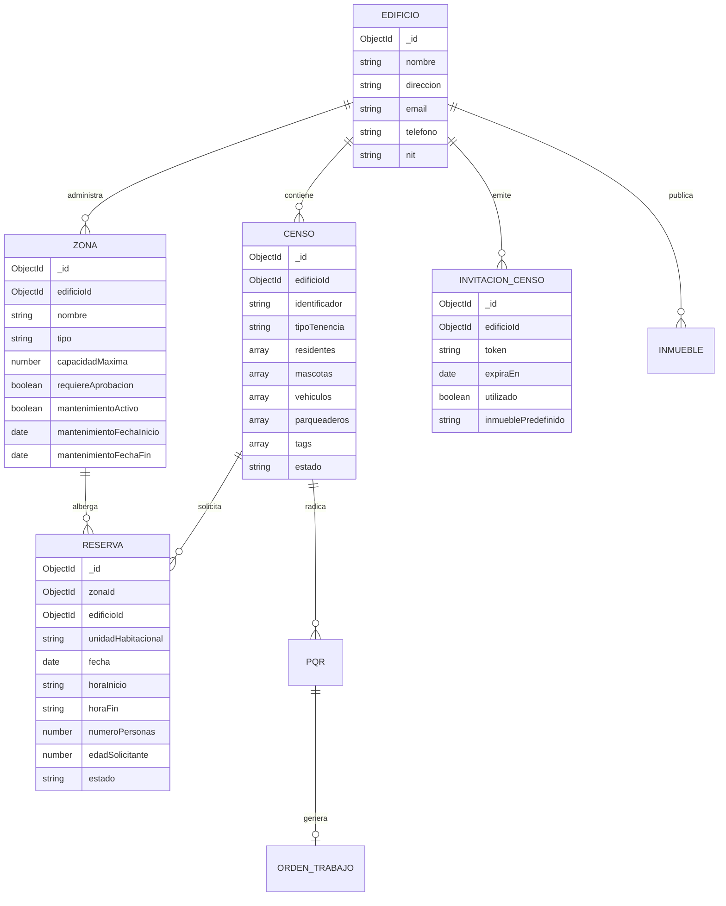

# Documento de Especificación de Requisitos de Software (SRS / ERS)
### Estándar IEEE 830 / ISO/IEC/IEEE 29148 — Versión 1.0
**Proyecto:** Zonas Aforo (PropTech SaaS para Propiedad Horizontal)  
**Fecha de Emisión:** 20 de Octubre de 2026  
**Clasificación:** Confidencial / Documento Técnico de Arquitectura e Ingeniería  
**Estado:** Aprobado / Línea Base de Requisitos

---

## Control de Versiones del Documento
| Versión | Fecha | Autor / Rol | Descripción de Cambios | Estado |
| :---: | :---: | :---: | :--- | :---: |
| **0.1** | 10/10/2026 | Arquitectura Core | Borrador preliminar de módulos de Zonas y Censo MVP. | Archivado |
| **0.5** | 15/10/2026 | Equipo de Desarrollo | Incorporación de flujos de reservas, Websockets e Importador Excel. | En Revisión |
| **1.0** | 20/10/2026 | Product Owner & Lead Architect | Especificación formal IEEE 830 / ISO 29148: Matriz RBAC, 33 Requisitos Funcionales, 15 Reglas de Negocio, 6 Casos de Uso Tabulados, RNF ISO 25010 y Gobernanza IoT. | **Aprobado** |

---

## 1. Introducción y Alcance del Producto

### 1.1 Propósito
El presente documento define la **Especificación de Requisitos de Software (SRS / ERS)** formal para la plataforma **Zonas Aforo**, estructurado bajo el estándar internacional **IEEE 830-1998** y su evolución en **ISO/IEC/IEEE 29148:2018**. Este documento actúa como el contrato técnico y funcional definitivo entre los accionistas del negocio, administradores de copropiedad, equipo de arquitectura de software, ingenieros de desarrollo y auditores de aseguramiento de calidad (QA).

### 1.2 Alcance del Producto (Zonas Aforo SaaS)
**Zonas Aforo** es una solución integral **PropTech multi-inquilino (Multi-Tenant SaaS)** orientada a la administración operativa, demográfica, logística, comunitaria y financiera de urbanizaciones, conjuntos residenciales, edificios multifamiliares y condominios. 
El sistema trasciende la administración documental tradicional al incorporar:
1. **Control Dinámico de Aforo en Tiempo Real:** Motor de prevención de sobrecupo concurrente en áreas comunes (piscinas, gimnasios, salones comunales, BBQ, canchas) asistido por WebSockets bidireccionales y telemetría de conteo físico.
2. **Censo Habitacional Multidominio & Autoservicio Criptográfico:** Padrón digital completo de 6 hojas estructuradas (residentes, niños, adultos mayores, mascotas con póliza de manejo especial, vehículos, parqueaderos y bodegas) respaldado por tokens de un solo uso y códigos QR dinámicos.
3. **Mantenimiento Preventivo y Mesa de Ayuda PQR:** Flujo cerrado de tickets ciudadanos con radicado legal consecutivo y conversión en un solo clic a órdenes técnicas para operarios de campo en aplicación móvil ligera.
4. **Seguridad 360 y Portería Digital:** Control de accesos vehiculares vía reconocimiento de placas (LPR Hikvision ISAPI), control peatonal FaceID/QR, registro ágil de paquetería/casillero virtual y minuta digital para guardas.
5. **Gobernanza Financiera Conectada:** Cruce de cartera en mora que restringe de forma automatizada los privilegios recreativos en zonas comunes y habilita la recepción y conciliación de comprobantes de pago.
6. **Marketplace Inmobiliario Interno:** Portal exclusivo verificado para venta y arriendo directo de inmuebles entre copropietarios, eliminando intermediarios y estafas.

### 1.3 Marco Legal y Normativo de Referencia
* **Ley 675 de 2001 (Colombia):** Régimen de Propiedad Horizontal. Establece las facultades del Administrador, derechos y deberes sobre bienes comunes, asambleas y sanciones no pecuniarias por mora.
* **Ley 1581 de 2012 y Decreto 1377 de 2013:** Régimen General de Protección de Datos Personales (Habeas Data). Rige la captura y almacenamiento de documentos de identidad, certificados de tradición, datos biométricos de menores y títulos de propiedad.
* **Ley 1801 de 2016 (Código Nacional de Seguridad y Convivencia Ciudadana):** Artículos correspondientes a la tenencia de caninos de manejo especial (razas potencialmente peligrosas) que exigen póliza de responsabilidad civil extracontractual.
* **ISO/IEC 25010:2011:** Modelo de Calidad del Producto de Software (Requisitos No Funcionales).

### 1.4 Definiciones, Acrónimos y Abreviaturas
* **Aforo Concurrente:** Cantidad máxima de personas que pueden coincidir simultáneamente dentro de un recinto o zona delimitada en un bloque temporal específico.
* **Censo Digital:** Estructura de datos normalizada que asocia una unidad habitacional privada a sus ocupantes, vehículos, mascotas y bienes anexos.
* **DoD (Definition of Done):** Criterio de aceptación técnico para considerar una funcionalidad completa y desplegable a producción.
* **Inmueble Predefinido:** Restricción de seguridad que enlaza un enlace/token criptográfico exclusivamente al apartamento asignado por el administrador.
* **LPR (License Plate Recognition):** Reconocimiento automatizado de placas vehiculares mediante visión artificial.
* **Moroso:** Unidad habitacional que presenta obligaciones financieras vencidas con la copropiedad, perdiendo acceso a áreas comunes no esenciales según la Ley 675 de 2001.
* **PQR:** Peticiones, Quejas, Reclamos y Sugerencias radicadas por los residentes.
* **RBAC (Role-Based Access Control):** Control de acceso basado en roles y privilegios granulares.

---

## 2. Descripción General del Producto y Modelo de Negocio

### 2.1 Propuesta de Valor y Ventajas Competitivas
Frente a soluciones tradicionales del mercado (p. ej. Vecindapp, Munily, Dayvo) que operan como directorios estáticos o aplicaciones nativas lentas con altos índices de deserción:
* **Cero Fricción de Descarga (Web PWA):** Funciona en cualquier navegador moderno de escritorio y móvil sin forzar descargas en App Store / Play Store.
* **Telemetría Física y Control Real de Aforo:** Combina reservas de software con integración directa a hardware (ISAPI Hikvision, SpeedFace ZKTeco) para apertura y conteo físico real.
* **Procesador Masivo de Alto Rendimiento:** Capacidad demostrada de procesar libros Excel de 6 hojas y más de 500 apartamentos en menos de 2.5 segundos mediante operaciones bulk en MongoDB.
* **Garantía Criptográfica de Autoservicio:** Los códigos QR de auto-censo expiran a los 7 días y son de un solo uso estricto, impidiendo suplantación o modificación de unidades ajenas.

### 2.2 Modelo de Negocio y Monetización (SaaS B2B2C)
1. **Suscripción Anual por Copropiedad (Cobro por Unidad Residencial):**
   * *Plan Básico (Gestión y Censo):* $2.500 COP / unidad / mes.
   * *Plan Pro (Aforo, Reservas, PQR, Portal Web y Marketplace):* $3.800 COP / unidad / mes.
   * *Plan Enterprise (IoT, Portería 360, LPR, Citofonía y WhatsApp Bot):* $5.500 COP / unidad / mes.
2. **Módulos Add-On de Telemetría e Hardware:** Venta o arrendamiento de talanqueras, cámaras LPR y terminales de reconocimiento facial con fee de mantenimiento mensual.
3. **Comisión Transaccional por Pagos de Administración:** 1.5% + $900 COP sobre pagos procesados mediante pasarela de pagos integrada.

### 2.3 Perfiles de Usuario y Actores del Sistema
| Identificador | Rol de Usuario | Descripción y Contexto de Operación | Interfaz Principal |
| :---: | :--- | :--- | :--- |
| **ACT-01** | **Superadministrador (SaaS Admin)** | Operador global del sistema. Gestiona la creación de edificios, suscripciones, facturación SaaS y configuración de infraestructura. | Portal Maestro SaaS |
| **ACT-02** | **Administrador de Copropiedad** | Administrador legal del edificio o conjunto residencial. Configura zonas, parámetros de aforo, aprueba censos, audita finanzas y gestiona proveedores. | Dashboard Web Admin (/dashboard) |
| **ACT-03** | **Propietario / Arrendador** | Titular legal del apartamento. Puede censar a su grupo familiar, radicar PQR, reservar zonas, pagar administración y publicar su inmueble en venta/arriendo. | Portal Residente (/dashboard) |
| **ACT-04** | **Arrendatario / Residente** | Ocupante legítimo no propietario. Accede a reservas de zonas autorizadas, radicación de PQR y casillero virtual. Restringido para publicar inmuebles en venta. | Portal Residente (/dashboard) |
| **ACT-05** | **Operario Técnico de Mantenimiento** | Personal de mantenimiento, aseo o proveedores técnicos. Recibe órdenes de trabajo convertidas desde PQR, actualiza checklists y registra evidencia fotográfica. | Portal Ligero Móvil (/operario) |
| **ACT-06** | **Guarda de Seguridad / Vigilante** | Personal de portería. Opera la minuta de visitantes, lectura de códigos QR de invitados, ingreso de paquetería y control de talanqueras/LPR. | Consola de Portería (/porteria) |
| **ACT-07** | **Visitante / Usuario Público** | Invitado temporal, comprador potencial de inmueble o residente completando auto-censo mediante enlace/QR público seguro sin login previo. | Rutas Públicas (/censo/*, /invitacion/*, /inmuebles/*) |

---

## 3. Matriz de Control de Acceso Basado en Roles (RBAC)

La siguiente matriz define de forma estricta los privilegios permitidos sobre los recursos del sistema:
* **C:** Crear (*Create*) | **R:** Consultar / Leer (*Read*) | **U:** Actualizar / Editar (*Update*) | **D:** Eliminar (*Delete*) | **A:** Aprobar / Auditar (*Approve*) | **-:** Sin Acceso (*Deny*)

| Módulo / Recurso del Sistema | Superadmin | Admin Copropiedad | Propietario | Residente (Arrendatario) | Operario Técnico | Vigilante (Portería) | Público / Visitante |
| :--- | :---: | :---: | :---: | :---: | :---: | :---: | :---: |
| **Gestión de Edificios y Configuración** | CRUD | R/U | R (Solo Datos Públicos) | R (Solo Datos Públicos) | - | - | R (Solo Metadatos Públicos) |
| **Censo Masivo (Excel / Wizard)** | CRUD | CRUD | - | - | - | - | - |
| **Padrón Habitacional (Residentes/Mascotas)** | CRUD | CRUD/A | R/U (Solo su Unidad) | R/U (Solo su Unidad) | - | R (Solo Consulta Emergencia) | C (Vía Token Único) |
| **Configuración de Zonas Comunes** | CRUD | CRUD | R | R | R | R | R (Público) |
| **Motor de Reservas y Calendario** | CRUD | CRUD/A | C/R/D (Solo su Unidad) | C/R/D (Solo su Unidad) | R | R (Consulta Diaria) | C (Solicitud con Validación) |
| **Bloqueo por Mantenimiento** | CRUD | CRUD | R | R | R/U | R | R |
| **Marketplace de Inmuebles** | CRUD | CRUD/A | C/R/U/D (Solo sus Inmuebles) | R | - | - | R (Catálogo Público) |
| **Mesa de Ayuda PQR** | CRUD | R/U/A | C/R (Solo sus PQR) | C/R (Solo sus PQR) | R (Asignadas) | - | - |
| **Órdenes de Trabajo de Mantenimiento** | CRUD | CRUD/A | R (Estado de su PQR) | R (Estado de su PQR) | R/U (Checklist/Fotos) | - | - |
| **Portería, Minuta y Visitantes QR** | CRUD | R/A | C (Genera QR Invitado) | C (Genera QR Invitado) | - | CRUD | R (Presenta QR) |
| **Casillero Digital y Correspondencia** | CRUD | R | R (Su Unidad) | R (Su Unidad) | - | C/R/U (Recepción/Entrega) | - |
| **Control Financiero y Cartera (Mora)** | CRUD | CRUD/A | R (Su Estado de Cuenta) | R (Su Estado de Cuenta) | - | R (Solo Tag Moroso/Al Día) | - |
| **Telemetría IoT (LPR, Cámaras, Torniquetes)** | CRUD | CRUD/R | - | - | - | R/U (Apertura Manual) | - |

---

## 4. Requisitos Funcionales (RF) Módulo por Módulo

### 4.1 Módulo 1: Autenticación, Gobernanza Multi-Tenant y Usuarios
* **RF-01 (Aislamiento Multi-Tenant):** Toda entidad de base de datos debe almacenar obligatoriamente la referencia indexada `edificioId`. Ninguna consulta o mutación puede retornar o alterar datos pertenecientes a otra copropiedad.
* **RF-02 (Autenticación Robusta JWT):** El sistema debe emitir tokens de sesión firmados mediante algoritmo HMAC SHA-256 con tiempo de expiración configurable (por defecto 7 días).
* **RF-03 (Registro y Onboarding de Administradores):** El sistema debe proveer una interfaz de registro en `/auth/register` que cree simultáneamente la cuenta del administrador y el registro maestro del edificio.
* **RF-04 (Seguridad de Credenciales):** Las contraseñas deben cifrarse obligatoriamente mediante **bcrypt** con un factor de trabajo (*salt rounds*) no inferior a 10 antes de su persistencia.

### 4.2 Módulo 2: Censo Habitacional Digital e Importador Masivo
* **RF-05 (Importador Masivo de 6 Hojas):** El sistema debe procesar libros de Excel (.xlsx, .xls) con capacidad de 500 apartamentos en menos de 3 segundos, parseando concurrentemente las pestañas: `Inmuebles`, `Residentes`, `Mascotas`, `Vehiculos`, `Parqueaderos` y `Bodegas`.
* **RF-06 (Wizard Guiado de 4 Pasos):** La interfaz de carga masiva en Next.js debe implementar un wizard con pasos: 1) Carga de Archivo, 2) Mapeo de Hojas/Columnas, 3) Previsualización en Cuadrícula Editable y 4) Confirmación con Inserción en Lote (*bulkWrite*).
* **RF-07 (Autoservicio Criptográfico de Censo):** El sistema debe permitir al administrador generar enlaces individuales con tokens hexadecimales impredecibles de 48 caracteres generados mediante entropía criptográfica (`crypto.randomBytes(24)`).
* **RF-08 (Validación Estricta de Enlace Único):** Al consultar un token en `GET /api/censo/public/invitacion/:token`, el sistema debe verificar que no haya expirado y que `utilizado === false`. En caso contrario, debe responder con código `400 Bad Request`.
* **RF-09 (Trazabilidad de Actualizaciones):** Si un residente diligencia un censo para una unidad previamente existente y aprobada, el sistema debe registrar la información con el estado `pendiente_actualizacion`, requiriendo aprobación explícita del administrador antes de sobreescribir el padrón oficial.

### 4.3 Módulo 3: Motor de Zonas Comunes, Reservas y Control Dinámico de Aforo
* **RF-10 (Parametrización de Zonas Comunes):** El administrador debe poder crear y configurar zonas definiendo: nombre, descripción, tipo (recreativa, salón social, deportiva, húmeda), capacidad máxima (`capacidadMaxima`), horario de apertura y cierre, tiempo de anticipación de reserva y bandera de aprobación obligatoria (`requiereAprobacion`).
* **RF-11 (Prevención de Sobrecupo Concurrente):** El motor en `reservas.service.ts` debe calcular en tiempo real la sumatoria de personas para todas las reservas en estado `activa` o `aprobada` que coincidan en el intervalo solicitado. Si la suma más la nueva solicitud supera la `capacidadMaxima`, la petición debe rechazarse de forma atómica con `400 BadRequestException`.
* **RF-12 (Sincronización WebSocket en Tiempo Real):** El backend debe emitir eventos mediante Socket.io (`aforo-actualizado`, `reserva-creada`, `mantenimiento-toggle`) a la sala del edificio (`edificio_${id}`) para que los navegadores conectados actualicen la barra visual de aforo sin requerir recarga de página (*F5*).
* **RF-13 (Gestión de Ventanas de Mantenimiento):** El administrador debe poder programar o activar inmediatamente el estado de mantenimiento para una zona. Durante dicha ventana, el sistema debe bloquear cualquier intento de reserva y notificar a los usuarios con reservas previas.
* **RF-14 (Reportes y Métricas de Ocupación):** El sistema debe generar reportes consolidados calculando el porcentaje real de ocupación (`ocupacion = (reservasConcluidas / capacidadTotalHistorica) * 100`) agrupado por zona y rango de fechas.

### 4.4 Módulo 4: Portal Inmobiliario Interno (Venta y Arriendo)
* **RF-15 (Publicación Exclusiva para Propietarios Verificados):** Solo los usuarios asociados a unidades censadas con tenencia `propietario` y estado `aprobado` pueden radicar solicitudes de publicación de inmuebles.
* **RF-16 (Optimización Automática de Imágenes a WebP):** Las fotografías subidas para los anuncios deben ser procesadas en el backend mediante la biblioteca **sharp**, redimensionadas y convertidas a formato `.webp` con compresión optimizada, garantizando un peso inferior a 250 KB por imagen.
* **RF-17 (Visibilidad Diferenciada en Dashboard):** El administrador debe visualizar en su panel (`/dashboard/inmuebles`) todos los estados de inmuebles (`activa`, `vendida`, `arrendada`, `pendiente_aprobacion`), mientras que el portal público solo expondrá inmuebles con estado `activa`.

### 4.5 Módulo 5: Operaciones Técnicas, Mantenimiento y Radicación PQR
* **RF-18 (Radicación de PQR con Radicado Consecutivo):** El residente puede radicar PQR asociando categoría, asunto, detalle y adjuntos. El sistema asignará un número de radicado legal inmutable con formato `PQR-YYYY-XXXXX`.
* **RF-19 (Conversión 1-Clic a Orden de Trabajo):** El administrador puede transformar cualquier PQR en una orden técnica de trabajo mediante un modal de asignación que pre-diligencia los datos y asigna un operario técnico.
* **RF-20 (Portal Ligero Móvil de Operarios):** Los operarios técnicos dispondrán de una interfaz PWA móvil donde consultarán sus órdenes asignadas, marcarán ítems de listas de verificación (*checklist*) y subirán fotografías de antes y después del trabajo realizado.

### 4.6 Módulo 6: Notificaciones Transaccionales Omnicanal
* **RF-21 (Notificaciones por Correo Transaccional):** Disparo automático de correos HTML institucionales ante eventos clave: confirmación de reserva, aprobación de censo, radicado de PQR y llegada de paquetes.
* **RF-22 (Integración con WhatsApp Business API / Bot):** Envío de mensajes de plantilla aprobados por Meta para notificaciones urgentes y habilitación de bot interactivo para consultar aforos y registrar visitas.
* **RF-23 (Campana de Alertas In-App):** Centro de notificaciones reactivo en el encabezado del dashboard con contador de novedades no leídas y redirección directa al recurso afectado.

### 4.7 Módulo 7: Seguridad 360, Portería Digital, Paquetería y Minuta
* **RF-24 (Autorización de Visitantes con Código QR):** Los residentes pueden generar invitaciones temporales con código QR para sus visitantes. El guarda de seguridad escaneará el código para registrar el ingreso con un solo toque.
* **RF-25 (Casillero Virtual y Correspondencia):** El guarda registra la llegada de encomiendas o cartas físicas asociando la unidad habitacional, empresa de mensajería y foto de la guía. El sistema notifica de inmediato al residente vía push/email.
* **RF-26 (Tarificador de Parqueaderos de Visitantes):** Registro de entrada y salida de vehículos de visitantes con cálculo automatizado de tarifa por minutos u horas según el reglamento interno de la copropiedad.
* **RF-27 (Minuta Digital de Novedades):** Bitácora digital donde el equipo de vigilancia consigna novedades del turno, inventario de llaves y rondas con registro de hora exacta e imposibilidad de borrado o alteración.

### 4.8 Módulo 8: Telemetría IoT, Hardware LPR, FaceID y Conteo Físico
* **RF-28 (Recepción de Eventos LPR Hikvision ISAPI):** Endpoint HTTP Listening capaz de recibir eventos en formato XML/JSON desde cámaras Hikvision con la placa detectada y abrir automáticamente la talanquera si el vehículo está censado como autorizado.
* **RF-29 (Sincronización de Rostros y QR con Terminales ZKTeco / Hikvision):** Transmisión de credenciales de acceso a terminales biométricos de zonas comunes, habilitando el torniquete únicamente durante el horario exacto de una reserva aprobada.
* **RF-30 (Telemetría de Conteo Físico de Personas):** Conexión a cámaras de flujo de personas para contrastar el aforo medido físicamente contra las reservas registradas en el software.

### 4.9 Módulo 9: Gestión Financiera, Cartera y Estados de Cuenta
* **RF-31 (Generación y Visualización de Estados de Cuenta):** Módulo para que los copropietarios consulten su extracto de cuotas de administración ordinarias y extraordinarias en formato digital y PDF descargable.
* **RF-32 (Recepción y Conciliación de Comprobantes de Pago):** Carga de soportes de transferencia bancaria por parte del residente con flujo de revisión y aprobación administrativa.
* **RF-33 (Sincronización Automática de Bandera de Morosidad):** Al confirmarse un saldo en mora, el sistema añadirá de inmediato la etiqueta `moroso` en la colección `Censo`, activando las restricciones automáticas de zonas comunes.

---

## 5. Catálogo de Reglas de Negocio (RN) y Restricciones del Dominio

* **RN-01 (Aforo Máximo Estricto Concurrente — Sobrecupo Cero):**  
  Ninguna reserva puede ser confirmada o aprobada si la cantidad de personas solicitadas (`numeroPersonas`) sumada a las personas de las reservas ya confirmadas (`activa` o `aprobada`) en la misma zona y franja horaria supera el campo `capacidadMaxima` de la zona.  
  *Fórmula de validación:*  
  $$sum 	ext{Personas}_{	ext{Reservas Existentes}} + 	ext{Personas}_{	ext{Nueva Solicitud}} le 	ext{Capacidad Máxima}$$

* **RN-02 (Bloqueo Preventivo por Morosidad):**  
  Toda unidad habitacional identificada con la etiqueta `tags.includes('moroso')` o cuyo estado financiero reporte mora activa queda automáticamente inhabilitada para crear o solicitar reservas en zonas recreativas o sociales. No obstante, conserva acceso a zonas y trámites esenciales (asambleas, PQR de urgencia).

* **RN-03 (Restricción de Mayoría de Edad en Reservas):**  
  El solicitante de una reserva debe ser mayor de 18 años (`edadSolicitante >= 18`). En caso contrario, el sistema rechaza la solicitud de reserva con el mensaje formal: *"Solo mayores de 18 años pueden realizar reservas"*.

* **RN-04 (Expiración y Un Solo Uso de Tokens QR de Censo):**  
  Los enlaces y códigos QR individuales de auto-censo poseen una vigencia máxima inmutable de 7 días naturales (`diasValidez = 7`). Una vez diligenciado y enviado el formulario con éxito, el registro en base de datos marca de forma irreversible `utilizado = true`. Cualquier intento posterior de reutilización debe ser rechazado de inmediato con error 400.

* **RN-05 (Inmutabilidad de Unidad en Invitaciones Predefinidas):**  
  Si un token de invitación fue emitido con el atributo `inmueblePredefinido` (ej. *"Torre 2 - Apto 401"*), tanto la interfaz web como el controlador de backend deben forzar y validar estrictamente que los datos correspondan a dicha unidad. El usuario no podrá modificar el identificador ni registrar datos para un apartamento ajeno.

* **RN-06 (Ventanas de Mantenimiento Preventivo / Correctivo):**  
  Si una zona común se encuentra con la bandera `mantenimientoActivo = true` y la fecha/hora de la reserva coincide con la ventana `[mantenimientoFechaInicio, mantenimientoFechaFin]`, el sistema debe denegar la reserva indicando la indisponibilidad por labores técnicas.

* **RN-07 (Prioridad de Bloqueo Administrativo):**  
  Las reservas o bloqueos realizados directamente por el Administrador de la copropiedad gozan de precedencia jerárquica sobre solicitudes ciudadanas pendientes de aprobación, permitiendo cancelar o reubicar solicitudes previas mediando notificación justificada.

* **RN-08 (Validación Documental Obligatoria en Mascotas de Manejo Especial):**  
  Todo canino clasificado en el censo bajo razas de manejo especial (según la Ley 1801 de 2016) requiere obligatoriamente el cargue del archivo PDF o imagen correspondiente a la **Póliza de Responsabilidad Civil Extracontractual** vigente y el Carné de Vacunación al día.

* **RN-09 (Aprobación Administrativa de Modificaciones de Censo):**  
  Ninguna solicitud de actualización enviada por un residente a través de enlace público sobreescribirá de inmediato los datos del padrón oficial si la unidad ya se encuentra en estado `aprobado`. La solicitud se almacena como `pendiente_actualizacion` hasta que el administrador verifique los soportes documentales.

* **RN-10 (Restricción de Publicación Inmobiliaria a Propietarios Aprobados):**  
  Los usuarios con rol de arrendatario o residentes secundarios no tienen autorización para publicar anuncios en el portal de venta/arriendo. El sistema verifica que la cédula del solicitante coincida con el registro titular de la propiedad en el censo.

* **RN-11 (Aislamiento Operativo del Personal de Seguridad y Técnico):**  
  El Guarda de Seguridad y el Operario Técnico no tienen acceso bajo ninguna circunstancia a los saldos financieros, extractos bancarios ni documentos privados de identidad de los residentes, limitándose estrictamente a sus pantallas operativas de control de acceso y órdenes de trabajo.

* **RN-12 (Aislamiento de Base de Datos y Tenant):**  
  El identificador `edificioId` debe actuar como condición de filtrado obligatoria en cada consulta de lectura y mutación ejecutada contra la base de datos MongoDB.

---

## 6. Casos de Uso Principales (UC) y Flujos Detallados

### Caso de Uso 01: Auto-Censo de Residente mediante Enlace / QR de Un Solo Uso
* **Identificador:** UC-01
* **Actor Principal:** ACT-07 (Residente / Usuario Público)
* **Precondición:** El Administrador (ACT-02) ha generado una invitación temporal asociada a una unidad habitacional predefinida.
* **Flujo Principal (Paso a Paso):**
  1. El residente escanea el código QR o abre la URL en su navegador: `https://app.zonasaforo.com/censo/invitacion/:token`.
  2. El frontend ejecuta `GET /api/censo/public/invitacion/:token`.
  3. El backend verifica la existencia del token, confirma que no haya expirado (`expiraEn > now`) y que `utilizado === false`.
  4. El sistema responde con los datos del edificio y el campo `inmueblePredefinido` (ej. *"Torre 1 - Apto 502"*).
  5. La interfaz bloquea el selector de apartamento, mostrando un badge de "Unidad Bloqueada" y presenta el formulario de censo en pestañas: Datos Personales, Mascotas, Vehículos.
  6. El residente diligencia la información de su núcleo familiar, adjunta documentos (cédula, carné de vacunación) y presiona "Enviar Censo".
  7. El backend procesa la petición en `POST /api/censo/public/invitacion/:token/responder`.
  8. El backend verifica que el identificador enviado coincida con `inmueblePredefinido`.
  9. Si no existía censo previo, se crea con estado `pendiente`. Si existía censo aprobado, se crea con estado `pendiente_actualizacion`.
  10. El backend marca de inmediato `token.utilizado = true`.
  11. El residente recibe un mensaje de confirmación y el Administrador visualiza la solicitud en su panel de auditoría.
* **Flujos Alternos y Excepciones:**
  * **3a. Token Expirado o Ya Utilizado:** El backend rechaza la petición con código 400. El frontend despliega una pantalla de error: *"Este enlace ha caducado o ya fue utilizado. Solicite uno nuevo a la administración"*.
  * **8a. Discrepancia de Unidad Habitacional:** Si la petición intenta enviar un apartamento distinto al del token, el backend aborta la transacción con `400 Bad Request`.

### Caso de Uso 02: Solicitud y Validación de Reserva con Aforo y Morosidad
* **Identificador:** UC-02
* **Actor Principal:** ACT-03 / ACT-04 (Propietario / Residente)
* **Precondición:** El residente está autenticado o accede mediante la ruta pública autorizada del edificio; la zona está activa y no está en mantenimiento.
* **Flujo Principal (Paso a Paso):**
  1. El residente ingresa al módulo de Zonas Comunes, selecciona una zona (ej. *"Zona Húmeda - Piscina"*) y consulta la disponibilidad.
  2. El sistema muestra la capacidad máxima, horarios y el indicador de aforo actual en tiempo real vía WebSockets.
  3. El residente selecciona fecha, franja horaria (ej. 10:00 a 12:00), cantidad de asistentes (`numeroPersonas = 4`) y digita su edad (`edadSolicitante = 28`).
  4. El residente envía la solicitud de reserva.
  5. El backend consulta el estado de la unidad habitacional en la colección `Censo`.
  6. El backend comprueba que la unidad no posea la etiqueta `moroso` (RN-02).
  7. El backend comprueba que `edadSolicitante >= 18` (RN-03).
  8. El backend calcula la sumatoria de personas para reservas en estado `activa` o `aprobada` en dicho horario.
  9. Al verificar que el total más los 4 nuevos asistentes no supera la capacidad máxima de la zona (RN-01), se registra la reserva.
  10. Si la zona tiene `requiereAprobacion === false`, la reserva se guarda como `activa`; de lo contrario, queda en estado `pendiente`.
  11. El backend emite el evento WebSocket `aforo-actualizado` hacia todos los clientes conectados del edificio.
  12. El residente recibe el comprobante digital de reserva en pantalla y por correo.
* **Flujos Alternos y Excepciones:**
  * **6a. Unidad en Mora:** El backend responde con error 400: *"La unidad habitacional presenta restricciones por mora en cuotas de administración"*.
  * **7a. Solicitante Menor de Edad:** El backend responde con error 400: *"Solo mayores de 18 años pueden realizar reservas"*.
  * **9a. Sobrecupo Concurrente:** El backend responde con error 400: *"El número de personas supera el aforo disponible para la franja seleccionada"*.

### Caso de Uso 03: Radicación de PQR y Conversión en 1-Clic a Orden Técnica
* **Identificador:** UC-03
* **Actores:** ACT-03/04 (Residente), ACT-02 (Administrador), ACT-05 (Operario Técnico)
* **Precondición:** Residente autenticado en la plataforma.
* **Flujo Principal:**
  1. El residente radica una solicitud describiendo una falla en ascensor o fuga de agua comunal.
  2. El sistema genera el consecutivo legal `PQR-2026-00128`.
  3. El Administrador recibe la notificación en su bandeja de PQR.
  4. El Administrador hace clic en "Convertir en Orden de Trabajo".
  5. Un modal emergente precarga automáticamente los datos de la PQR, solicita seleccionar el operario técnico disponible y la fecha límite.
  6. El Administrador confirma la acción. El sistema crea la entidad `OrdenTrabajo` vinculada a la PQR y actualiza el estado de la PQR a `en_proceso`.
  7. El operario asignado recibe la notificación en su aplicación móvil ligera.
  8. Al finalizar la reparación, el operario marca el checklist de tareas, adjunta fotografía de evidencia y cierra la orden.
  9. La PQR se actualiza a estado `resuelta` y el residente recibe la notificación de cierre con encuesta de satisfacción.

---

## 7. Requisitos No Funcionales (RNF) — Estándar ISO/IEC 25010

### 7.1 Rendimiento y Eficiencia en Desempeño
* **RNF-01 (Tiempo de Respuesta API):** El 95% de las peticiones REST de consulta y validación deben responder en un tiempo inferior a **200 milisegundos** bajo condiciones estándar de carga.
* **RNF-02 (Procesamiento Masivo de Archivos):** La importación completa de un archivo Excel de 500 unidades y 6 hojas estructuradas no debe superar los **3.0 segundos** de procesamiento en backend.
* **RNF-03 (Latencia de WebSockets):** La propagación de eventos de cambio de aforo (`aforo-actualizado`) entre el servidor Socket.io y los clientes conectados no debe exceder los **150 milisegundos**.

### 7.2 Seguridad y Protección de la Información
* **RNF-04 (Cifrado en Tránsito y Reposo):** Todas las comunicaciones cliente-servidor deben canalizarse estrictamente bajo protocolo **HTTPS / TLS 1.3**. La base de datos MongoDB debe contar con cifrado de volumen en reposo.
* **RNF-05 (Protección Contra Ataques de Fuerza Bruta):** Implementación obligatoria de **Rate Limiting (NestJS Throttler)** con umbral máximo de 10 peticiones por minuto para endpoints de autenticación (`/auth/login`) y 100 peticiones por minuto para endpoints generales.
* **RNF-06 (Sanitización y Validación de Entrada):** Uso integral de `ValidationPipe` en NestJS con `whitelist: true` y `forbidNonWhitelisted: true` para prevenir ataques de inyección NoSQL y mutaciones no autorizadas.
* **RNF-07 (Cumplimiento de Habeas Data):** Separación lógica y autorización expresa de tratamiento de datos personales conforme a la Ley 1581 de 2012, permitiendo la anonimización de datos históricos ante solicitudes de eliminación.

### 7.3 Concurrencia y Sincronización
* **RNF-08 (Transaccionalidad Atómica en Reservas):** Las operaciones de cálculo de aforo y creación de reserva deben ejecutarse con control de concurrencia para evitar condiciones de carrera (*race conditions*) que pudieran generar sobrecupo en situaciones de reservas simultáneas masivas.

### 7.4 Disponibilidad y Resiliencia
* **RNF-09 (Acuerdo de Nivel de Servicio - SLA):** La plataforma debe garantizar una disponibilidad de servicio mensual mínima del **99.5%** (excluyendo ventanas de mantenimiento previamente notificadas).
* **RNF-10 (Recuperación Automática del Túnel y Conexión):** El microservicio de conexión con bases de datos remotas y agentes de hardware debe incorporar reconexión exponencial automática ante desconexiones de red.

### 7.5 Usabilidad, Ergonomía y Accesibilidad
* **RNF-11 (Diseño Responsivo Total):** Todas las pantallas del frontend deben ser 100% funcionales y adaptativas en resoluciones móviles desde 360px hasta pantallas ultra-wide 4K.
* **RNF-12 (Accesibilidad Web WCAG 2.1):** Las interfaces deben cumplir los estándares de contraste y accesibilidad nivel AA para usuarios con discapacidad visual o motriz.

---

## 8. Arquitectura del Modelo de Datos y Esquemas Principales

El sistema fundamenta su persistencia en MongoDB / Mongoose con colecciones normalizadas y referencias relacionales mediante `Types.ObjectId`:

---

## 9. Integración de Hardware y Telemetría IoT (Roadmap Fase 2)
1. **Control de Acceso Vehicular LPR:** Recepción de paquetes HTTP Listening desde cámaras Hikvision con apertura automática de talanquera vía relevador TCP/IP si la placa está en la lista blanca de la colección `Censo`.
2. **Terminales FaceID / Código QR Dinámico:** Integración con dispositivos Hikvision MinMoe y ZKTeco SpeedFace para sincronización de credenciales de acceso peatonal restringidas estrictamente al horario de reservas activas.
3. **Cámaras de Conteo Físico (People Counting):** Detección de paso bidireccional (entradas vs. salidas) para calibrar el aforo real físico de gimnasios y piscinas en tiempo real.

---

## 10. Criterios de Aceptación General y Definición de Terminado (DoD)
Para que cualquier módulo o funcionalidad sea promovida al ambiente de producción, debe satisfacer de forma obligatoria:
1. **100% de Pruebas Unitarias Aprobadas:** Cobertura de pruebas en NestJS / Jest y componentes Next.js sin errores ni advertencias críticas.
2. **Batería E2E del Flujo de Administrador Aprobada (43/43 PASS):** Verificación de todo el ciclo de vida desde registro, importación de Excel, creación de zonas, aforos, reservas y control de morosos.
3. **Validación de Ciberseguridad y Tipado Estricto:** Cero errores de TypeScript en compilación estricta, DTOs protegidos con class-validator y rate limiting activo.
4. **Trazabilidad en Notion y Control de Versiones:** Commits debidamente versionados en los repositorios de Git y tareas sincronizadas en estado `Completado` dentro de la gobernanza de Notion.
